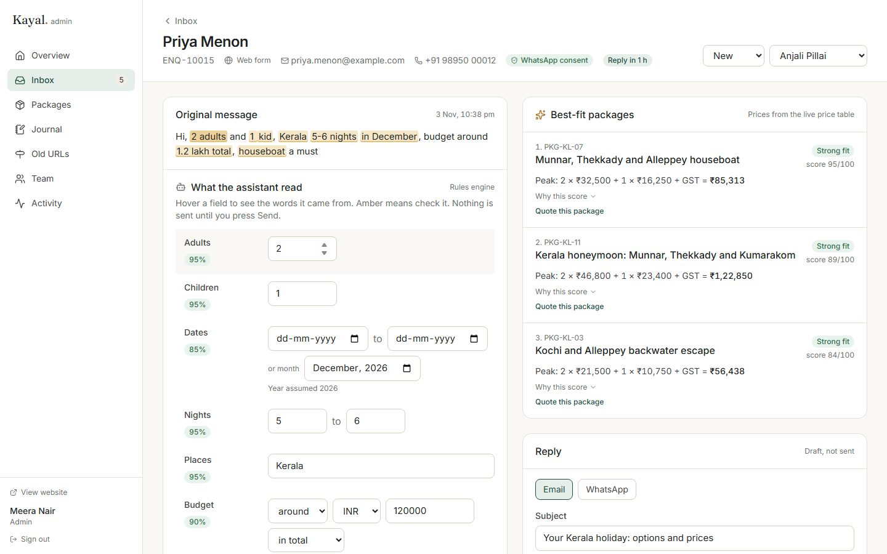

# Kayal Holidays: tour operator website, package CMS and enquiry inbox

A working build for Company A, a Kochi tour operator selling Kerala and South India holidays
(brief 1). Travellers browse server-rendered package pages, read journal posts that lead to the
right package, and send enquiries. Content staff edit packages with seasonal prices, preview and
version history. Consultants answer every enquiry, from
any channel, in one inbox, where an assistant has already read the message, suggested three
packages and drafted a reply with prices taken from the price table.

- **Technical design:** [docs/TDD.pdf](docs/TDD.pdf)
- **Run and deploy:** [deployment.md](deployment.md)



## What works

| Area | Highlights |
| --- | --- |
| Public site | Home, search with filters, destination pages, package pages with day-by-day itinerary, hotels, seasonal price table, live price calculator, route map, one Enquire button. Server-rendered, cached, sitemap, robots, JSON-LD, 308 redirects from old URLs. |
| Package CMS | Create, edit, duplicate, seasonal prices with gap and overlap checks, photos (library or upload), preview, signed share link, publish now or schedule, version history with diffs, restore, unpublish. |
| Journal | Blog CMS with toolbar editor and live preview, categories, SEO fields, package cards inside posts, related trips under each post (with suggestions from the text), and links back from package pages. |
| Old URLs and team | Admin-managed 308 redirects for the old site with a checked CSV import and visit counts. Team screen to add staff, change roles, reset passwords and deactivate safely. |
| Enquiries | Web form with consent, simulated WhatsApp, email and chat webhook, logging of phone calls. Instant acknowledgement, auto-assignment, one-working-hour reply timer, notes, status, quotes as link and PDF. |
| AI assist | Extracts travellers, dates, nights, places, budget and must-haves with evidence and confidence; ranks packages with a visible score; drafts a reply. Optional LLM second opinion. Nothing is sent without a person. |
| Roles | Admin, content editor, travel consultant, traveller. Activity log of every change. |

## Quick start

```bash
npm install
cp .env.example .env.local   # then set APP_SECRET (any 32+ character string)
npm run db:setup             # creates data/kayal.db and loads demo data
npm run dev                  # http://localhost:3000
```

Demo accounts (password `kayal-demo-2026`): `admin@example.com`, `editor@example.com`,
`anjali@example.com` (consultant), `traveller@example.com`.

## Tests

```bash
npm test            # 107 unit tests: pricing, extraction, suggestions, SLA, versions, Markdown, team rules, redirects
npm run build && npm run test:e2e   # 21 Playwright runs, desktop and phone (resets demo data)
node scripts/perf.mjs               # LCP on throttled slow 4G, needs a running production server
```

## Stack

Next.js 16 (App Router, server actions), React 19, TypeScript, Tailwind CSS 4, Drizzle ORM on
libSQL (SQLite file locally, Turso in production), Zod, Vitest, Playwright.

Photographs are from Wikimedia Commons under CC licences; see `/credits`.
